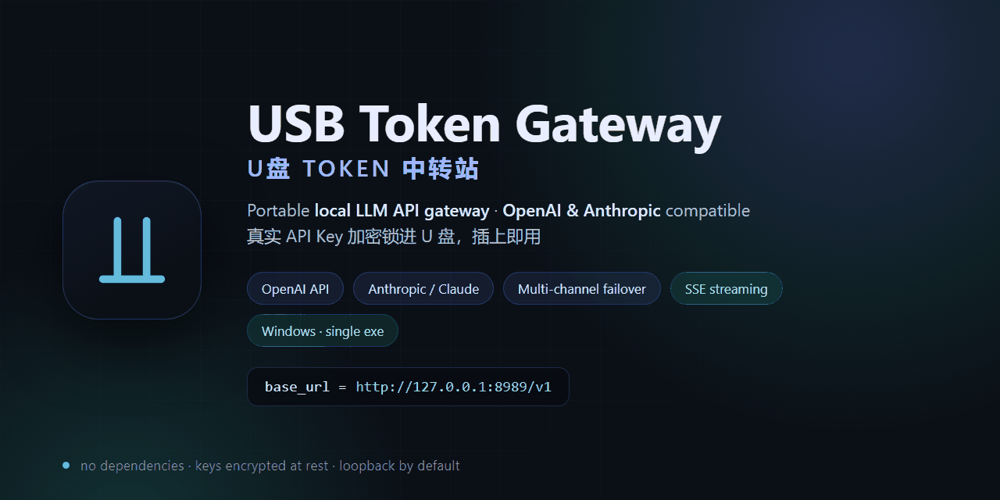

# USB Token Gateway · U盘 Token 中转站

[](LICENSE)
[](go/go.mod)
[](README.md)
[](README.md)

> **A portable local LLM API gateway that lives on a USB stick.**
> Plug it into any Windows PC, double-click, and every app on that machine gets an
> **OpenAI-compatible** endpoint *and* a **native Anthropic (Claude) endpoint** at
> `http://127.0.0.1:8989/v1`. Your real upstream API keys stay **encrypted on the stick** —
> your projects, scripts and agent configs only ever see a revocable local key.
>
> 便携式**本地 LLM 网关** / **Token 中转站**：把真实 API Key 加密锁进 U 盘，插到任意 Windows
> 电脑双击即用；下游项目只认本地地址 + 网关自签发的 key，上游 key 全程不出设备。



## 痛点 / Pain points

**你是不是也这样：**

- **Key 一堆，轮换全靠手** —— OpenAI、Claude、各家中转站攒了一堆 API key：这个 429 了、那个额度见底了，就得挨个项目改配置、挨个重启。
- **换台电脑就抓瞎** —— 临时在别人的电脑 / 公司机器 / 出差笔记本上干活，懒得把一堆 key 拷过去；明文 `.env` 拷来拷去，用完还删不干净。
- **配置比干活还累** —— 每台电脑、每个客户端都要重新填一遍 `base_url` 和 key。
- **想在远程服务器 / 新电脑上直接用 Codex？** —— 装 Node、配 key、写 `auth.json`，折腾半天才能开聊。现在插上 U 盘双击「启动 Codex.bat」就直接开干，随时用。

**一个 U 盘就够了** —— 它是即插即用的 Token 中转站：

1. 插进电脑、双击一下，面板**一键复制**固定的本地端口和 key（`http://127.0.0.1:8989/v1` + `sk-usb-…`）
2. 所有客户端永远只认这一组配置——一次填好，换电脑也不用重填
3. 多渠道**自动轮换**（failover / 轮询 / 加权），熔断、429 冷却全自动，哪个 key 出事都无感切换
4. 你随身携带的**最强大脑**：真实 key 加密锁在 U 盘里，**数据不外泄**；**拔出即走**，不担心 key 泄露被别人偷走

## 特性 / Features

- **Drop-in OpenAI endpoint** — `/v1/chat/completions`、`/v1/models`、`/v1/embeddings`；任何 OpenAI SDK / 客户端只要改 `base_url`
- **Native Anthropic endpoint** — `/v1/messages`（含流式 `message_start → content_block_delta → message_stop`），Claude 官方 SDK 直连
- **OpenAI Responses endpoint** — `/v1/responses`（含 SSE 事件流），**Codex CLI 原生直连**
- **内置 Codex 一键启动** — `usb-bridge.exe --codex`（或托盘「启动 Codex」/「启动 Codex.bat」）：未登录先弹登录页、解锁瞬间自动拉起 Codex；面板勾选「Codex」Key（单选）与模型名后实时写进 U 盘 `bridge\codex\{auth.json,config.toml}`，`CODEX_HOME` 指向 U 盘、对话历史不留主机
- **Multi-channel routing** — `failover` / `round_robin` / `weighted` / `least_errors`，5 分钟健康窗 + 熔断 + 429 冷却 + 重试预算
- **Protocol translation** — OpenAI ⇄ Anthropic 双向转换（请求体、响应体、SSE 事件流）
- **Encrypted keys at rest** — Argon2id + AES-GCM，`config.vault` 全程密文，原子落盘
- **Remember this device** — Windows DPAPI 绑定当前用户/机器，换电脑或换账户自动失效
- **Portable by design** — 单文件 exe、零运行库依赖、配置随 U 盘走
- **Local-first security** — 默认只监听 `127.0.0.1`，局域网访问必须显式开启

## 兼容客户端 / Works with

任何允许自定义 `base_url` 的客户端都能直接接入（示例）：

Claude Code（`ANTHROPIC_BASE_URL`）· OpenAI Codex CLI（内置一键启动）· Cursor · Cline · Continue · ChatBox · NextChat ·
LobeChat · Cherry Studio · Open WebUI · OpenAI 官方 SDK · Anthropic 官方 SDK ·
LangChain / LlamaIndex · 以及任何 OpenAI 兼容的 Agent / App。

```
你的项目 ──► http://127.0.0.1:8989/v1  +  sk-usb-…（网关签发）
                     │
                     ├── 多渠道轮换：failover / round_robin / weighted / least_errors
                     ├── 熔断 + 冷却恢复 + 失败重试预算
                     └── OpenAI ⇄ Anthropic 双向协议转换（含 SSE 流式）
                                  │
                                  └──► 上游：OpenAI / Claude / 任何兼容站点（Key 加密存放）
```

**交付形态**：拿到 `usb-bridge.exe` → 拷进 U 盘 → 插到任意 Windows 电脑 → 双击 → 托盘静默运行。
首次在这台电脑输一次主密码，之后**双击即用、不弹浏览器**。它是单文件静态二进制，
不需要装 Go、不需要任何运行库、也不需要项目其它文件。

> **exe 走 GitHub Releases**（构建产物不入库）：Release 附件里同时挂 `usb-bridge.exe`
> 与 `使用说明.txt`。
> ⚠️ 上传或分享时**绝不要带上 `bridge/` 目录**——那里面是你的加密配置 `config.vault`
> 与「记住本机」凭据 `session.key`。

---

## 快速开始

### 1. 拿到 exe

二选一：

- **从 Releases 下载** `usb-bridge.exe`（只想用的人走这条）。
- **自己构建**（需要 Go 1.21+）：

  ```powershell
  powershell -ExecutionPolicy Bypass -File .\build.ps1     # 产物：usb\usb-bridge.exe
  ```

拷到 U 盘（或任意目录）双击即可；第一次运行会自己创建数据目录 `bridge/`。
Linux/macOS 网关本体也能跑（托盘/进程接管等 Windows 专属能力自动降级）：

```sh
./build.sh release        # 产物：usb/usb-bridge
```

### 2. 首次使用（新电脑）

双击 `usb-bridge.exe` → 自动打开面板 `http://127.0.0.1:8989/admin`：

1. 设置**主密码**（≥8 位，加密你的全部 API key，丢了无法找回）→ 勾选「记住这台设备」
2. 「渠道」里填入上游 API（OpenAI / Claude / 任何兼容站）的 base_url + key + 模型
3. 「下游私有 Key」生成 `sk-usb-…`，面板最上方「快速接入」可一键复制地址 / Key / 模型

### 3. 日常使用

| 场景 | 行为 |
|---|---|
| 本机已记住 | 双击 → **静默解锁** → 自动探针 → 托盘气泡「启动成功」，**不开浏览器、不输密码** |
| 本机已记住但有渠道不通 | 只弹气泡提醒，不打扰；要排查 → 右键托盘「打开控制面板」 |
| 换到新电脑 | 弹一次面板要主密码，输一次即记住这台机器 |
| 重复双击 | 自动接管：旧实例退出、新实例接力（配置落盘是原子写，强杀安全） |

托盘菜单：打开控制面板 / 重新测活渠道 / 锁定 / 退出。

## 接入方式

一个下游 key（`sk-usb-…`，`Authorization: Bearer` 或 `x-api-key` 都收）走全部端点：

| 端点 | 协议 | 用途 |
|---|---|---|
| `POST /v1/chat/completions` | OpenAI | 绝大多数客户端 / SDK |
| `POST /v1/messages` | Anthropic 原生 | Claude 官方 SDK、Claude 语法 App |
| `POST /v1/responses` | OpenAI Responses | Codex CLI（内置一键启动） |
| `GET /v1/models` | OpenAI | 模型列表 |
| `POST /v1/embeddings` | OpenAI | 向量 |
| `ANY /proxy/<channel_id>/…` | 原样反代 | 直通某个指定渠道 |

```bash
curl http://127.0.0.1:8989/v1/chat/completions \
  -H "Authorization: Bearer sk-usb-xxxxxxxx" -H "Content-Type: application/json" \
  -d '{"model":"gpt-4o-mini","messages":[{"role":"user","content":"hi"}]}'
```

**手机 / 其他设备**：面板「设置」勾选「允许局域网访问」并重启（监听 `0.0.0.0`），
手机连同一 WiFi 用 `http://<电脑IP>:8989/v1`；跨网络建议 [Tailscale](https://tailscale.com)。
默认只听 `127.0.0.1`——这是刻意的安全默认。

## 安全模型

- `config.vault` **永远密文落盘**：新建用 Argon2id，兼容读取原型时代的 scrypt 库
- 「记住这台设备」= 主密码经 **Windows DPAPI**（当前用户作用域）加密存
  `bridge/session.key`，**换电脑 / 换 Windows 账户都解不开**；vault 拷走也打不开
- 下游 key 独立于主密码：可限有效期、可随时停用/删除；「锁定」后所有下游调用 503
- 面板管理接口需要 `X-Admin-Token`；已解锁时本机浏览器可经
  `GET /admin/token`（**仅接受回环请求**）自动领取本次会话令牌，免密进入面板；
  局域网设备永远拿不到该令牌
- 用量/审计只写本地（`bridge/` 目录），不上传任何数据

**不防**：本机管理员权限、内存取证、键盘记录、以及物理接触运行中的设备。详见
[DESIGN.md](DESIGN.md) 的威胁模型。

## 目录结构

```
build.ps1 / build.sh   一键构建（自动定位 go，无需任何个人路径）
go/                    正式版（Go，单文件 exe，无第三方运行时依赖）
  main.go              入口：托盘 / 启动探针 / 记住解锁 / 实例接管
  instance_windows.go  重复双击接管、端口占用者识别（同族网关自动顶替）
  balloon_windows.go   托盘气泡通知（复用品牌图标）
  icon.go / icon_windows.go  运行时渲染品牌图标（与网页 favicon 同几何与渐变）
  internal/vault/      加密配置（Argon2id 写 / 双后端读）
  internal/bridge/     网关状态机（锁定 / 解锁 / 管理令牌 / 端口）
  internal/server/     HTTP 网关（/v1/*、/proxy、/admin、SSE、双协议转换）
  internal/webui/      内嵌单文件控制面板（page.html）
  internal/sched/      轮换策略 + 熔断 + 冷却
  internal/probe/      启动探针、internal/remember/ DPAPI 记住本机
python/                早期 Python 原型（用于跨语言 vault 互通验证，作为参考实现保留）
tests/                 mock 上游 + 端到端测试（Go 78 项 / 原型 31 项）
usb/                   本机 U 盘交付目录（**整体不入库**，见 .gitignore）
                       = build.ps1 产出的 usb-bridge.exe + 使用说明.txt + 运行时数据 bridge/
```

## 开发与测试

```sh
go -C go vet ./...                 # 静态检查
go -C go test ./...                # 单元测试（图标编码 / Windows HICON 加载）
python tests/e2e_go.py             # Go 端到端 78 项（含跨语言解锁、记住本机、接管）
python tests/e2e_test.py           # Python 原型回归 31 项
python tests/repro_sse.py          # SSE 转换最小复现
```

环境变量（都有默认值，无需配置）：`GO_BIN` 指定 go 可执行文件、
`USBGW_DEV_EXE` / `USBGW_PORT_GATEWAY` / `USBGW_PORT_INTEROP` / `USBGW_PORT_MOCK`
用于换端口或换开发版产物名。

## 已知限制

- 受 Windows 与 U 盘策略限制，**做不到「插入即零点击自动运行」**，只能一键启动
- 面板与转发默认纯 HTTP（本机回环；局域网场景请只在可信网络使用）
- 协议转换目前覆盖文本与流式文本；复杂多模态内容（图片/工具调用的高级形态）以文本降级透传
- 未附许可证文件；若要开源发布请自行选择（例如 MIT）。
- 随附对外分发的 `usb-bridge.exe` 内含 `fyne.io/systray`（Apache-2.0）、`golang.org/x/crypto`、
  `golang.org/x/sys`（BSD-3-Clause）等第三方库；对外分发二进制时建议随包附上相应许可证文本。

## 设计文档

架构取舍、加密细节、启动与接管语义、威胁模型、决策记录：**[DESIGN.md](DESIGN.md)**。
